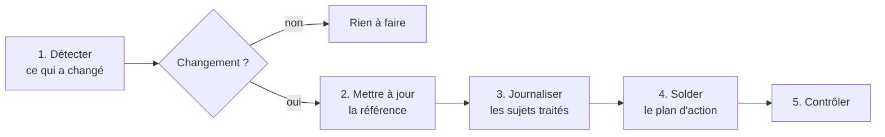

# 🔄 Protocole de mise à jour documentaire

<sub>[← Documentation](readme.md)</sub>

> La routine qui garde la documentation alignée sur le code et archive les sujets traités.
> Elle s'exécute à intervalle régulier pendant le travail, et au plus tard avant chaque
> commit ([ADR-0002](decisions/adr-0002-documentation-dans-le-depot.md)).

## En bref



## 1. Détecter

Point de comparaison : le dernier passage de la routine (commit et état de l'arbre de
travail). Sources :

- `git log` depuis le dernier passage, `git status`, `git diff HEAD` ;
- les décisions prises en séance (validées par le décideur) ;
- les défauts ouverts ou fermés dans [GitHub Issues](https://github.com/chrraj7/S-Aloha/issues).

Si rien n'a changé, la routine s'arrête là.

## 2. Mettre à jour la référence

Chaque changement est replié dans le document de [`reference/`](reference/) concerné,
**sur place**. Correspondance :

| Ce qui a changé | Document à mettre à jour |
|---|---|
| `backend/Modules/*/Controllers`, routes, policies | [architecture](reference/architecture.md) § API, document de la pratique dans [`processus/`](reference/processus/readme.md) (§ 2 et § 9) |
| Règle de gestion d'une pratique (statuts, transitions, délais) | document de la pratique dans [`processus/`](reference/processus/readme.md) : marque 🔜 → ✅ quand la règle est implémentée |
| Règle commune (rôles, console, références, priorité) | [règles métier](reference/regles-metier.md) |
| `Models/Entities.cs`, `AppDbContext` | [base de données](reference/base-de-donnees.md) |
| `backend/Core/Auth`, `Program.cs` (auth, CORS, JWT) | [architecture](reference/architecture.md), [sécurité](reference/securite.md) |
| `appsettings.json`, `docker-compose.yml`, Dockerfiles | [exploitation](reference/exploitation.md) |
| `frontend/src/modules/registry.js` | [produit](reference/produit.md) (cartographie), [frontend](reference/frontend.md) |
| `App.jsx`, `core/`, `modules/*/pages` | [frontend](reference/frontend.md) § Routes et Structure |
| `styles.css`, thème, composants visuels | [frontend](reference/frontend.md) § Design ; captures d'écran |
| Nouveau terme métier ou technique | [glossaire](reference/glossaire.md) |
| Fonctionnalité visible par l'utilisateur | [README](../README.md), et une note dans [`changelog.d/`](../changelog.d/readme.md) pour le [journal des versions](../CHANGELOG.md) |
| Décision structurante actée | nouvel ADR dans [`decisions/`](decisions/readme.md) |

Une interface modifiée rend les **captures d'écran** obsolètes : les régénérer
(`docs/screenshots/`, mêmes noms de fichiers) depuis une instance chargée avec les données
du mode démonstration, sans enregistrement de test, trou de numérotation ni adresse interne
visible.

L'**image de partage** (`docs/screenshots/partage-1280x640.png`, 1280 × 640) reprend la
marque et la capture de la console : elle se refait avec elles. C'est aussi l'**aperçu
social** du dépôt, affiché quand un lien vers GitHub est partagé. GitHub n'offre aucune API
pour le changer : le mainteneur la téléverse à nouveau dans *Settings → General → Social
preview → Edit → Upload an image*.

## 3. Journaliser les sujets traités

Chaque sujet traité a **son propre fichier** : `archives/journaux/AAAA-MM-JJ-identifiant.md`,
où l'identifiant est l'issue ou la règle traitée (`2026-11-03-125.md`, `2026-11-03-per-07.md`),
en minuscules, chiffres et tirets. Deux PR ouvertes le même jour n'écrivent ainsi jamais
dans le même fichier, et aucun index n'est à tenir : le dossier, trié par nom, se lit dans
l'ordre chronologique. Une entrée est **figée** dès sa fusion, comme toute archive. Les
journaux d'un fichier par jour (`archives/journal-AAAA-MM-JJ.md`, jusqu'au 2026-11-02)
restent tels quels.

Format d'une entrée :

```markdown
# AAAA-MM-JJ — Titre du sujet

- **Quoi** : ce qui a été fait, en une ou deux phrases
- **Pourquoi** : le besoin, le défaut ou la décision d'origine
- **Fichiers** : les principaux fichiers touchés
- **Documentation** : les documents mis à jour, ADR créé le cas échéant
- **Commit** : l'issue ou l'identifiant traité (le hash n'existe qu'après la fusion)
```

Un journal n'est pas un changelog de fichiers : il raconte des **sujets** (une
fonctionnalité, un correctif, une décision), pour retrouver plus tard ce qui a été fait,
quand et pourquoi.

La note du **journal des versions** suit la même règle : une note par fichier dans
[`changelog.d/`](../changelog.d/readme.md), jamais dans `CHANGELOG.md` directement.
`python3 scripts/changelog.py` vérifie les notes (contrôle « Documentation » de la CI) ;
`--assembler` les verse dans la section « Non publié », à la passe de publication du lundi.
Une PR ouverte avant ce changement convertit son entrée et sa note à la prochaine mise à
jour de sa branche.

## 4. Solder le plan d'action

Un chantier terminé **quitte** [`plan-action.md`](plan-action.md) et rejoint l'entrée du
journal du jour (« Soldé du plan d'action : … »). Le plan ne garde que ce qui reste à
faire. Un chantier nouveau, découvert en cours de route, y entre.

## 5. Contrôler

```bash
python3 scripts/check-docs.py     # liens, ancres et chemins cités
```

Puis vérifier qu'aucun document ne cite de projet tiers privé, de secret réel ou d'outil
d'assistance, le dépôt étant public.

La routine **ne committe pas** : le commit reste une décision du mainteneur, qui y joint
la documentation mise à jour.

## 6. Publier le wiki

Le [wiki GitHub](https://github.com/chrraj7/S-Aloha/wiki) est un **miroir généré**
de `docs/` : il offre une lecture navigable (accueil, barre latérale, une page par
document de référence, par ADR, plan d'action et protocole), mais la documentation fait
foi dans le dépôt ([ADR-0002](decisions/adr-0002-documentation-dans-le-depot.md)). Chaque
page l'indique en tête ; une modification faite à la main dans le wiki est écrasée au
passage suivant. Les archives restent dans le dépôt.

Le wiki se régénère **après chaque poussée de `main` qui touche `docs/`**, pour qu'il ne
décrive jamais un état que le dépôt public n'a pas encore. Le workflow
[`wiki.yml`](../.github/workflows/wiki.yml) le fait de lui-même (et à la demande, depuis
l'onglet Actions) ; à la main, en secours :

```bash
git clone git@github.com:chrraj7/S-Aloha.wiki.git /tmp/s-aloha-wiki   # une fois
git -C /tmp/s-aloha-wiki pull
python3 scripts/sync-wiki.py /tmp/s-aloha-wiki
git -C /tmp/s-aloha-wiki add -A
git -C /tmp/s-aloha-wiki commit -m "Wiki régénéré depuis docs/ ($(git rev-parse --short HEAD))"
git -C /tmp/s-aloha-wiki push
```

Le script réécrit les liens : un document de `docs/` devient la page du wiki
correspondante, tout autre fichier pointe vers le dépôt, les images vers leur version
publiée.
